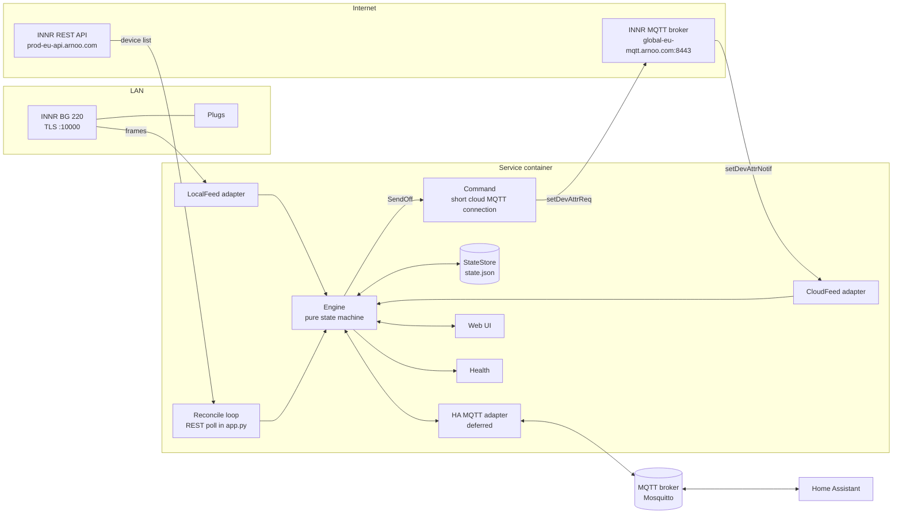

# Design: INNR Auto-Off Service

Implements `requirements.md`. Requirement ids (R1.1 ...) are referenced inline.

## 1. Key decisions

| # | Decision | Rationale |
|---|---|---|
| D1 | **Hybrid:** state from the local feed, commands through the INNR cloud. | Local gives state about 200 ms after a change and works without internet. Local commands were ignored by the bridge (verified). Cloud commands work (verified). |
| D2 | **Add the cloud feed as a second state source**. Local is primary, cloud feed is secondary, REST poll is the safety net. | See 1.1 below. |
| D3 | **Functional core, imperative shell.** The engine is a pure state machine (`events in, actions out`) with an injected clock. Network code lives in adapters. | R8.5: all timer logic testable without network and without waiting. |
| D4 | **Python 3.13, `asyncio`, one process.** Runtime dependency: `paho-mqtt` only. REST and the Web UI use the standard library. Dev dependency: `pytest`. | Small attack surface, simple multi-arch image (pure Python wheels). |
| D5 | **Config in TOML** (stdlib `tomllib`), **runtime state in JSON**, **secrets as files**. | No YAML dependency. Runtime overrides from HA must not rewrite the user's config file. |
| D6 | **Standalone first.** Home Assistant (through MQTT discovery) is an optional adapter, **deferred**: it is not needed for the goal. The core runs without it (R6.1) and is operated through the config file, logs and a `status` command (R6.6, R6.7). | No broker or HA needed for the actual goal. The adapter can be added later without touching the core; a custom integration could reuse the core too. |
| D7 | **Bias to OFF:** at expiry, state `ON` or `unknown` leads to an OFF command. | Switching OFF an OFF plug is harmless; failing to switch OFF is the real fault (R2.5). |
| D8 | **Commands use a short-lived cloud MQTT connection** (proven), the cloud feed uses a separate long-lived one (needs a spike, see 11). Both use the same MQTT client id (`<terminalIndex>-<userId>`), and MQTT 3.1.1 requires the broker to drop an existing client when another connects with the same id, so **the feed is paused for the duration of each command**. | Keeps the proven path untouched while the new one is validated; pausing avoids the two connections kicking each other. |
| D9 | **One multi-arch image** (`linux/arm64`, `linux/amd64`), non-root, read-only filesystem. | R5.6, R7.1. |
| D10 | **Plugs are discovered, not configured.** The device list from the cloud is the source of truth; new plugs start monitor-only. | R10. Adding a plug in the INNR app needs no file edit. Safe default because a plug may power something that must not be cut off. |
| D11 | **Web UI is built on the standard library** (`http.server` in a thread, server-rendered HTML, one small static script for live updates, no new dependency) with a **reduced version of the admin-GUI security profile** (section 17). | Single operator on a LAN. Fewer dependencies; no inline code allows a strict CSP (`script-src 'self'`), which closes gap G1 of the reference app. |

### 1.1 Why a cloud state feed (answer to the open question)

For:

- The local feed has a **blind spot of several seconds about every 30 s**. The bridge closes the connection and reconnecting took about 6 to 7 s in the investigation logs (including a 1 s backoff). An ON event in that window is missed. The 60 s REST reconcile closes the gap but up to a minute late.
- The cloud MQTT stream delivers the same `setDevAttrNotif` messages (observed in the proof run). The Homey community app depends on this stream.
- The two feeds have **independent failure modes** (LAN/TLS port vs. internet/broker). The local port is an undocumented service and could disappear with a firmware update. The cloud feed would keep the Service working.
- The Service needs the cloud for commands anyway, so it adds no new dependency.

Against / cost:

- The cloud broker also drops long-lived connections about every 30 s according to the Homey app source (it reconnects after 0.5 s and re-fetches the MQTT config each time). That gives its own small gaps, which are **not aligned with the local gaps**, so the two feeds cover each other.
- More code and more cloud traffic. Mitigated by keeping the feed optional (`[cloud] state_feed = true`) and by the spike in section 11 before relying on it.
- Verified live (spike S1): the cloud stream does report changes made elsewhere (INNR app, Alexa): on the NAS an ON reached the engine first through the cloud stream while the local feed was reconnecting.

Rule: **local is primary, cloud feed is secondary, REST poll is tertiary**. All three feed the same engine; the engine is idempotent (R1.6).

## 2. Architecture



Data flow for the main use case: the user switches a plug ON in the INNR app. The bridge pushes `OnOff = 1` (LocalFeed, and also CloudFeed). The engine starts a timer. At expiry the engine emits `SendOff`. The command connection publishes through the cloud. The bridge pushes `OnOff = 0`. The engine sees it and marks the command as confirmed.

## 3. Components

Package `src/innr_autooff/` (layout in section 12).

| Module | Responsibility | Depends on |
|---|---|---|
| `protocol.py` | Pure frame codec: `FrameParser.feed(bytes) -> payloads`, notification decoding, `OnOff` / `Watts` helpers (R1.3). | stdlib |
| `local_feed.py` | asyncio TLS client for the bridge: reconnect with backoff, legacy cipher scoped to this context, certificate pin (trust on first use) (R5.7, R5.8). Never writes to the socket (R4.3). | protocol |
| `innr_api.py` | Cloud REST: login (rate-limited), token refresh, houses, devices, `mqttConfig`. Persistent `terminalId` (R5.3). Request headers and login fields come from the injected `ClientProfile`, nothing is built in (R13). Blocking `urllib` calls, run through `asyncio.to_thread`. Registers every secret with the log scrubber. | stdlib, config, logging_util |
| `cloud_mqtt.py` | `CloudFeed`: long-lived MQTT subscription with reconnect and pause/resume; `send_command_blocking`: one short-lived connection per command, publishes `setDevAttrReq`, returns on the cloud's response. Final confirmation is a push *Observation*, not this result (R2.6). | paho |
| `discovery.py` | Pure: cloud device list to `PlugInfo` (type `plug`), untrusted text cleaned (R10). | models |
| `engine.py` | Pure state machine, see 4. No I/O, no clock access; every method takes `now`. | models |
| `models.py` | Observation, PlugInfo, PlugSettings, and the engine's actions (`SendOff`, `VerifyState`, `Persist`, `Log`). | none |
| `store.py` | Atomic 0600 JSON state file, tolerant loader, persistent terminal id (R3.1, R3.6, R5.3). | stdlib |
| `config.py` | TOML loading and validation, secrets from files, the placeholder guard for `bridge.host`, the `ClientProfile` of `[cloud.client]` with its validation (R5.1, R13). | stdlib |
| `logging_util.py` | Secret registry and scrubber, signal / decision logging, rotating files (R5.4, R12). | stdlib |
| `app.py` | Wiring: owns the engine on one asyncio loop, runs the reconcile / discovery loop, the tick, command execution and the health file; builds the read-only snapshot for the UI. | all of the above |
| `web/` | `server.py` (routes, sessions, request limits, log tail), `auth.py` (scrypt, sessions, lockout, CSRF), `render.py` (HTML, JS, view model), `audit.py`. | app (via a small interface) |
| `__main__.py` | CLI: `run`, `status`, `set-password`, `check-config`, `healthcheck`. | all |

Not built (deferred, R6.3): the Home Assistant adapter. The reconcile loop lives in `app.py` and the health file is written by the tick, so there are no separate `reconciler`, `cloud_commands` or `health` modules.

All long-running pieces run as asyncio tasks or threads owned by `app.py`; the loop is the single owner of the engine, other threads reach it only through `call_soon_threadsafe` / `run_coroutine_threadsafe`, so the engine needs no locks. A failed cloud call is logged and retried by the next cycle; the engine is stateless between calls except its data model, so a bad event cannot wedge it.

## 4. Engine

### 4.1 Types

```text
Observation(dev, onoff: 0|1, source: local|cloud|rest, observed_at: monotonic, idx: int|None)
PlugState   = UNKNOWN | OFF | ON_TIMING | ON_UNTIMED | SWITCHING_OFF
Action      = SendOff(dev, attempt) | Persist | Publish(dev) | Log(...)
Event       = Observed(Observation) | Tick() | CommandResult(dev, ok) | ConfigChanged(dev, ...) | SourceStatus(...)
```

`engine.handle(event, now) -> list[Action]`, with `now` = monotonic seconds for timing and a separate wall-clock value only for persistence (R3.7).

### 4.2 Per-plug state machine

States: `UNKNOWN`, `OFF`, `ON` (timer running, or untimed when auto-off is disabled) and `SWITCHING_OFF` (called *overdue* in the UI). Overdue has sub-phases: `sending` (command in flight), `waiting_plug` (cloud accepted, waiting for the OFF push), `verifying` (fresh snapshot ordered), `retry_wait` (next attempt scheduled).

| From | Event | To | Actions |
|---|---|---|---|
| UNKNOWN | push or snapshot ON/OFF | ON / OFF | startup policy (R3), Persist |
| OFF | push ON | ON | start timer `deadline = now + delay` (or untimed), Persist |
| ON | push ON | ON | none (R2.3) |
| ON | push OFF | OFF | cancel timer, Persist (R2.4) |
| ON | Tick, `now >= deadline` | SWITCHING_OFF (`sending`) | `timer_expired`, SendOff(attempt 1) |
| SWITCHING_OFF | push OFF | OFF | `command_confirmed`, reset attempts, Persist (R2.6) |
| SWITCHING_OFF `sending` | result: accepted | `waiting_plug` | `confirm_by = now + 15 s` |
| SWITCHING_OFF `sending` | result: failed, or no result after 60 s | `retry_wait` | `next_attempt_at = now + gap(attempt)` (R2.7); after attempt 3: `off_failed`, ERROR |
| SWITCHING_OFF `waiting_plug` | `confirm_by` passed, no OFF push | `verifying` | VerifyState (immediate snapshot), `verify_by = now + 30 s` (R2.11) |
| SWITCHING_OFF `verifying` | snapshot OFF requested >= 10 s after acceptance | OFF | `assumed_off`, reset attempts, Persist |
| SWITCHING_OFF `verifying` | snapshot ON, or `verify_by` passed | `retry_wait` | attempt counts as failed |
| SWITCHING_OFF `retry_wait` | Tick, `now >= next_attempt_at` | `sending` | SendOff(attempt n+1) |
| SWITCHING_OFF | settings: auto-off disabled | ON (untimed) | retries stopped, `overdue_cancelled` |
| SWITCHING_OFF | settings: delay changed | unchanged | no effect on an overdue plug (R2.12) |
| SWITCHING_OFF | plug missing from the cloud list | ON (no timer) | retries stopped (R10.5) |
| ON / SWITCHING_OFF | snapshot disagrees | per 4.3 | ignored, pending, or accepted (R1.10) |
| ON_* | all sources lost > 120 s | state kept, `stale` flag set | health degraded (R1.8); timer keeps running |
| ON | settings changed | ON | recompute `deadline = on_since + delay`; disabled leads to untimed (R2.9) |

`gap(n)` = 5 s for n = 1..3, 10 s for 4..6, 20 s for 7..9, 30 s for 10..12, 60 s for 13..15, 120 s from 16 on. Reaching the 2-minute cadence takes about 6 minutes (16 attempts); an outage of any length is bridged without a flood of requests, and the plug is switched off at most 2 minutes after the cloud is back. A failed attempt **never** produces a countdown: the timer only triggers the overdue state.

Late results: every `SendOff` carries its attempt number; `command_result` for an attempt other than the current one is ignored and logged.

At expiry with the `stale` flag set the engine still emits `SendOff` (D7, R2.5).

### 4.3 Source merge (R1.6, R1.7, R1.10)

- **Push sources** (local feed, cloud feed) emit Observations that are applied **in arrival order**. The state machine is idempotent for repeated values, so duplicate events from two feeds do nothing. If `idx` is the same counter on both feeds, duplicates can be dropped by `(dev, idx)` for cleaner logs; correctness does not depend on it.
- **REST snapshots** are weaker evidence: the INNR cloud lags the bridge (field evidence: at least 17 s). A snapshot `taken_at` (the instant the request was *sent*) is handled like this:
  1. State unknown: accepted (nothing better exists).
  2. Agrees with the known state: clears any pending claim, nothing else.
  3. Disagrees and a push Observation lies within 180 s before `taken_at` (or after it): **ignored** (`rest_ignored`, reason `within_push_grace`).
  4. Disagrees, no recent push: the first sighting is stored as a *pending claim* (`rest_pending`); a second matching snapshot at least 30 s later **accepts** it. An ON claim starts the timer counted from the first sighting. Any push or an agreeing snapshot discards the claim.
  5. During verification after an accepted OFF command (R2.11), a snapshot requested at least 10 s after the acceptance counts immediately, because it is the answer to a specific question.
- Asymmetry rationale: a stale "OFF" that cancels a running timer leaves a plug on forever, which is the failure to avoid; a missed OFF only costs one harmless extra command at expiry.

### 4.4 Timing

- The engine owns deadlines as monotonic values. `app.py` runs a 1 s tick; precision of up to 1 s is acceptable for 1-second to 24-hour delays.
- `on_since` and `deadline_utc` are stored as UTC wall clock for restart only. At startup the remaining time is converted to monotonic once (R3.3, R3.7).

## 5. Restart and persistence

State file `/data/state.json`:

```json
{
  "version": 1,
  "terminal_id": "random 21 chars (not a secret, identifies this client to the cloud)",
  "plugs": {
    "<devId>": {
      "state": "on",
      "on_since_utc": "2026-11-11T19:03:11Z",
      "overrides": { "enabled": true, "delay_seconds": 900 }
    }
  }
}
```

Startup sequence:

1. Load config and secrets; load the state file (corrupt means empty, warn).
2. Log in to the cloud; fetch the device list; read each plug's current `OnOff`.
3. For each plug: apply the restart policy (R3.3 to R3.5); if a deadline has already passed, the first tick emits `SendOff`.
4. Start the local feed, the cloud feed, the reconcile loop, the tick and the Web UI.
5. If login fails: retry with backoff; the container stays up but unhealthy (R6.4). No plug is touched.

Known limitation (documented, accepted): after a downtime, an ON plug with a persisted ON record is assumed to have been ON continuously. If it was switched OFF and ON again during the downtime, it can be switched off earlier than its delay. The effect is always on the safe side (earlier OFF).

## 6. Configuration

`config.toml` (mounted read-only; template `deploy/config.example.toml`):

```toml
[bridge]
host = "192.0.2.10"         # REQUIRED: the INNR bridge's LAN address; this documentation placeholder is refused
port = 10000
cert_sha256 = ""            # optional pin, empty = trust on first use, then pinned in state.json

[cloud]
region = "eu"
state_feed = true           # D2: cloud feed as second source
reconcile_seconds = 60

[cloud.client]              # REQUIRED, operator-supplied (R13); the template has the keys with empty values
app_id = ""                 # ... user_agent, package_name, app_version, web_version, build_number,
                            # os_version, web_view_version, device_model, device_name, origin

[defaults]
auto_off_enabled = true
delay_seconds = 1800
new_plug_auto_off = false   # newly discovered plugs start monitor-only (D10)
restart_policy = "resume"   # or "restart"

# optional seeds; the Web UI wins
# [[plugs]]
# dev_id = "00000000000000000000000000000001"
# name = "Coffee machine"
# auto_off_enabled = true
# delay_seconds = 1800

[web]
enabled = true
bind = "0.0.0.0"            # inside the container; compose publishes it on one LAN address only
port = 8480
refresh_seconds = 1
session_idle_seconds = 28800
session_max_seconds = 604800
tls_cert = ""
tls_key = ""
```

Environment / secrets:

| Name | Purpose |
|---|---|
| `INNR_EMAIL` | account e-mail |
| `INNR_PASSWORD_FILE` | path of the password file (Docker secret, mode 0600) |
| `LOG_LEVEL` | stdout level, `INFO` (default) or `DEBUG`; the signal / decision files always keep DEBUG |
| `INNR_CONFIG`, `INNR_DATA_DIR` | paths of `config.toml` and the data volume (set by the image) |

Precedence: runtime overrides in `state.json` over `[[plugs]]` values over `[defaults]`. The gateway id is not configured; it is read from the cloud device list (`parentId`).

## 7. Home Assistant contract (R6.3) - optional, deferred

Not part of the first releases (see D6). Kept here so the core's public API is designed to allow it later.

Operation without Home Assistant: per-plug settings in the Web UI; other settings by editing `config.toml` and restarting the container (a SIGHUP reload, R6.7, is not implemented); inspect with the Web UI, `docker exec innr-autooff innr-autooff status` (R6.6) and the logs (section 10).

Discovery topics under `homeassistant/<component>/innr_<devId>/<object>/config` (retained). One HA *device* per plug, all linked to a "INNR Auto-Off" parent.

| Entity | Type | State topic | Command topic |
|---|---|---|---|
| Plug power | `switch` | `innr_autooff/<dev>/onoff` (`ON`/`OFF`) | `.../onoff/set` (R4.2) |
| Power / Current / Voltage / Energy | `sensor` | `.../power`, `.../current`, `.../voltage`, `.../energy` | none |
| Auto-off enabled | `switch` | `.../auto/enabled` | `.../auto/enabled/set` |
| Auto-off minutes | `number` (1 to 1440) | `.../auto/minutes` | `.../auto/minutes/set` |
| Seconds remaining | `sensor` | `.../auto/remaining` (published every 10 s while timing) | none |
| Auto-off failed | `binary_sensor` | `.../auto/failed` | none |
| Local feed / Cloud feed connected | `binary_sensor` | `innr_autooff/status/local`, `.../cloud` | none |

Availability: `innr_autooff/status` with LWT payload `offline`. Writes to the command topics update the runtime overrides (persisted in `state.json`, R2.9). The HA adapter is a pure consumer/producer of the engine's public API, so removing it does not affect the core.

## 8. Error handling

| Failure | Detection | Behaviour |
|---|---|---|
| Bridge closes TLS (about every 30 s) | `recv` returns empty | Reconnect after 0.2 s, backoff reset after a successful frame |
| Bridge unreachable or rebooting | connect error | Backoff 1 s to 60 s; cloud feed and REST poll keep state flowing |
| Cloud MQTT drop | `on_disconnect` | Reconnect after 0.5 s, new `mqttConfig` each time |
| Internet down | REST/MQTT errors | State still from the local feed; OFF commands fail and are retried with growing gaps up to every 2 minutes (R2.7, R8.4); the plug is shown OVERDUE; health degrades after 120 s without any source |
| Login fails (wrong password) | 4xx on login | Log ERROR once per minute, unhealthy, no flapping logins (min. 60 s between attempts) |
| Access token expired | 401/403 | Refresh once, retry, else re-login |
| Command accepted, no OFF push | none within 15 s of the acceptance | fresh cloud snapshot decides (`assumed_off` or a failed attempt, R2.11) |
| Cloud answers with an old state | snapshot disagrees with the bridge | ignored / pending / accepted by the rules in 4.3 (R1.7, R1.10) |
| Malformed frame / JSON | parser | Resync on magic bytes, log WARN with length, never crash |
| State file corrupt | JSON error | Treat as empty, WARN, rename the bad file to `state.json.bad` |
| Clock jump | n/a | Timers are monotonic (R3.7) |
| HA broker down | paho callbacks | Core keeps running; HA adapter reconnects |
| Unhandled exception in a task | supervisor | Log traceback, restart the task with backoff |

## 9. Security

- Secrets: file-based, never logged. Every secret value is registered with the log scrubber when it is obtained (account password, tokens, device and MQTT passwords) and replaced by `***` in every handler; `mask()` additionally masks secret-looking dict keys. Tests assert that registered values never reach stdout or either log file (R5.4).
- Cloud client identity (R13): the cloud API is undocumented and only accepts requests that look like the official app. The values by which the Service identifies itself (application identifier, user agent, package name, versions, device model and name, web origin) are **operator configuration** (`[cloud.client]`); the repository ships none of them and a test fails if the known values of the official app ever appear in a tracked file. The Service refuses to start without them. **Risk:** using a third-party client may conflict with the provider's terms of service, and the API may change or block the client. The Service only ever uses the operator's own account and credentials; it does not bypass authentication, rate limits or access controls. Operating it is at the operator's own risk (`docs/CLOUD_CLIENT.md`). Mitigation: login attempts are rare, one persistent terminal id, polite backoff.
- The bridge TLS context disables certificate *chain* verification and enables `AES256-SHA256` at `SECLEVEL=0` **only for the single connection to the configured bridge address** (R5.8). The optional SHA-256 fingerprint pin (R5.7) restores authenticity of the endpoint on the LAN.
- Inbound: only the Web UI port (section 17), published on one LAN address of the host. The container needs outbound access to: bridge `:10000`, `prod-eu-api.arnoo.com:443`, `global-eu-mqtt.arnoo.com:8443`, and the MQTT broker if HA is used.
- Container: `USER 10001`, `read_only: true`, `cap_drop: [ALL]`, `security_opt: [no-new-privileges:true]`, tmpfs for `/tmp`, volume only at `/data` (R5.6).
- Supply chain: pinned base image and pinned dependency versions (with hashes via `pip --require-hashes` where practical); rebuild every 1 to 2 months for security fixes.
- Account blast radius: the NAS holds the account password. Preferred mitigation is a dedicated, shared INNR account (R5.9), to be checked in the test phase. Until then the secret file is `0600` and the NAS volume access is restricted.

## 10. Observability: signals and decisions (R12)

Two kinds of log lines, kept apart on purpose. A *signal* is something the Service **received**; a *decision* is something it **chose**, always with the reason. Reading both in time order reconstructs any incident (the 2026-11-12 incident could not be reconstructed from one mixed stream: the cloud's wrong answer was only visible as a decision without its input).

Line format (one event per line, key=value, ISO timestamp with offset): `2026-11-12T10:16:44+00:00 INFO kind=signal event=rest_snapshot plug="Coffee machine" onoff=1 known=0`.

| Where | Signals (`kind=signal`) | Decisions (`kind=decision`) |
|---|---|---|
| Adapters / app | `push` (source, plug, onoff or attrs, idx), `source_status`, `rest_snapshot`, `command_ack` (ok, seconds, reason), `cloud_error` (call, reason), `ui_settings`, `ui_switch`, `ui_login` | none |
| Engine | none | `timer_started/cancelled/recomputed/expired`, `observation`, `plug_on`, `plug_off`, `rest_ignored`, `rest_pending`, `rest_accepted`, `reconcile_diff`, `send_off`, `command_failed`, `command_unconfirmed`, `verify_ordered`, `assumed_off`, `command_confirmed`, `auto_off_failed`, `overdue_cancelled`, `plug_discovered/missing/returned/forgotten`, `startup_policy`, `settings_changed`, `command_result_stale` |

- **Sinks.** Stdout (`docker logs`) gets everything at the configured level. In addition `/data/logs/signals.log` and `/data/logs/decisions.log` (rotating, 2 MB x 3) receive only their kind and **always at DEBUG**, so power attributes and agreeing snapshots are kept there without flooding the container log.
- **Volume.** About 8 local notifications per minute plus 2 snapshot lines per minute: roughly 1 MB per day in `signals.log`; decisions are a few lines per day.
- **Web UI.** `GET /log/signals` and `GET /log/decisions` return the last 500 lines as plain text (login required, `nosniff`); the dashboard footer links to them.
- **Helper.** `deploy/deploy-nas.sh fetch-logs [hours]` copies both files and the operational log from the NAS into `logs/nas/` in the workspace (one sudo prompt), then removes the temporary copy on the NAS.
- **Secrets.** The scrubber runs on every handler (R5.4). Cloud errors are logged as `ExceptionType: first 160 characters of the message`; request URLs in such messages carry no credentials (tokens travel in headers).
- Health: `/tmp/innr-autooff.health` timestamp file updated each tick when healthy; Docker `HEALTHCHECK` fails if older than 120 s (R6.4).
- Optional counters (R6.5) published on the HA status topics.

## 11. Spikes

| Spike | Question | Result |
|---|---|---|
| S1 | Does the cloud MQTT broadcast changes made *elsewhere* (INNR app, Alexa)? | **Yes.** Observed live: an ON arrived first through the cloud stream while the local feed was reconnecting. D2 stands. |
| S2 | Do local and cloud notifications share the `idx` counter? | Open. Only affects optional de-duplication; correctness does not depend on it. |
| S3 | How often does the cloud broker drop the long-lived connection? | Open; watch `source_status source=cloud_feed` in `signals.log`. The feed reconnects by itself. |
| S4 | How long is the refresh token valid; are "new phone" e-mails gone with the persistent terminal id? | Open; tokens refreshed every 2 h without trouble so far (`cloud_token_refreshed` in the log). |
| S5 | Does a shared (secondary) INNR account see and control the plugs? | Open (R5.9). |

## 12. Repository layout

```text
.
  README.md, pyproject.toml, requirements.txt (hash-pinned), requirements-dev.txt
  Dockerfile, .dockerignore, .gitignore
  .kiro/specs/innr-auto-off/{requirements,design,tasks}.md
  docs/DEPLOY.md                     runbook: Mac test, then NAS
  docs/CLOUD_CLIENT.md               the cloud client identity: keys, legal notes, how to configure
  LICENSE, NOTICE, SECURITY.md       GPL-3.0 text; credits and trademark notice; vulnerability reporting
  src/innr_autooff/                  the service (section 3); web/ for the UI
  tests/
    unit/                            engine (incl. the incident replay), protocol, config, store, discovery, logging
    integration/                     fake TLS bridge, fake REST opener, fake MQTT client, whole Service against fakes
    web/                             Web UI security and behaviour; dashboard script run in Node against a fake DOM
  deploy/
    compose.yaml, config.example.toml, env.example, site.env.example, client.toml.example
    merge-client-profile.sh          replaces only the [cloud.client] table of a config (idempotent, refuses other tables)
    build-push.sh                    tests in Linux, build (--load) or multi-arch push (--push), sha tag, dirty-tree check
    deploy-local.sh                  run on this Mac
    deploy-nas.sh + nas-remote.sh    deploy to the NAS (health check, rollback, fetch-logs)
    smoke-test.sh                    offline checks of a built image
```

Git-ignored and kept locally only: `input/` (investigation notes), `prototype/` (throw-away scripts), `logs/`, `deploy/site.env`, `deploy/client.toml`.

## 13. Test strategy

| Level | What | Covers |
|---|---|---|
| Unit (no network, fake clock) | Engine transitions, every row of 4.2; repeated ON; manual OFF; two plugs; expiry in `unknown`; the escalating retry schedule to the second; late results; command timeout; the 2026-11-12 incident replayed (stale snapshot after a confirmed OFF, acknowledged command to an already-OFF plug); snapshot grace and two-sighting rules; config change recompute; restart policies; clock-jump immunity; REST staleness rule | R2, R3, R1.6, R1.7, R8.5 |
| Unit | Frame parser: partial frame, 2 frames in one read, junk prefix, bad length, invalid JSON, byte-at-a-time feeding | R1.3 |
| Unit | Logging masks real secrets (property test with random secrets) | R5.4 |
| Integration | Fake bridge: TLS server using `AES256-SHA256`, replays recorded frames, drops the connection every N seconds; the Service must keep correct state across drops | R1.1, R1.8, R5.8 |
| Integration | Fake cloud: HTTP server for login/devices/mqttConfig, fake MQTT port; verify token refresh, re-login, command confirm/fail/retry | R2.6, R2.7, R5.2 |
| Integration | HA adapter against a pinned Mosquitto container (not built; deferred with R6.3) | R6.3 |
| Image | Container starts non-root with read-only fs; health check fails/passes as specified; runs on `linux/arm64` natively and `linux/amd64` under emulation | R5.6, R6.4, R7.1, R7.4 |
| Live (manual, runbook A4) | Real bridge/cloud with a harmless plug: ON in app, OFF after delay; cancel by manual OFF; restart while timing; network loss | R2, R3, R8.3 |
| Soak | Days of normal use on the NAS: count `reconcile_diff`, `auto_off_failed`, `rest_ignored` and reconnects in the logs; memory growth | R8.1 to R8.3 |

End-to-end acceptance scenarios (live):

1. A1: ON via app, auto OFF after the delay, confirmed in the logs and the dashboard.
2. A2: ON, manual OFF at 50 % of the delay, no command is sent.
3. A3: ON, restart the container at 50 %, plug is switched OFF at the original deadline.
4. A4: ON, disconnect the Mac from the internet at expiry, then reconnect, plug is switched OFF after reconnect.
5. A5: change the delay in the Web UI while a timer runs, deadline recomputed.
6. A6: both plugs ON with different delays, each switches off on its own time.
7. A7: ON during a forced local-feed gap, the event is still seen (cloud feed or reconcile).
8. A8: after a completed auto-off no phantom countdown appears although the cloud list lags (the 2026-11-12 incident).

## 14. Packaging and deployment

### 14.1 Image

- `FROM python:3.13-slim-bookworm@sha256:<multi-arch index digest>` (pinned in the `Dockerfile`; no moving tag).
- Multi-stage build: `build` installs the hash-pinned dependency into a virtualenv, `test` runs the whole test suite inside Linux, `runtime` copies the virtualenv and the source (no tests, no secrets), runs as `USER 10001`, has a `HEALTHCHECK` and OCI labels `source` and `revision`.
- `.dockerignore` is an allow-list: nothing outside `requirements*.txt`, `pyproject.toml`, `src/`, `tests/` and the config template enters the build context.
- Tag `sha-<8-char git sha>` from a clean tree only (`--load` on a dirty tree gives a local `-dirty` tag that cannot be pushed); never `latest`; an existing tag is never overwritten.

### 14.2 Stage 1: Mac (arm64)

`deploy/build-push.sh --load` (tests in Linux, then build), `deploy/smoke-test.sh` (offline checks: non-root, read-only root, secret readable by uid 10001, placeholder host handling, Web UI and log pages, health check), `deploy/deploy-local.sh sha-<8>` (compose with the data volume, secrets outside the repository, port published on 127.0.0.1 only), then the acceptance checks A1 to A8 of the runbook. The Mac is the staging environment, not production: a laptop that sleeps stops the service.

### 14.3 Stage 2: Synology NAS (amd64)

1. `deploy/build-push.sh --push`: tests for linux/amd64 (emulated) and linux/arm64, multi-arch push to a **private** GHCR package, manifest verification.
2. One-time: `deploy-nas.sh login` stores a read-only (`read:packages`) token for `sudo docker` on the NAS; `deploy-nas.sh secret` stores the INNR password (mode 400, owner uid 10001). Both are typed on the Mac with hidden input and streamed over ssh stdin; nothing secret is an argument.
3. `deploy-nas.sh deploy sha-<8>`: uploads compose file and scripts, creates `config.toml` once (bridge address from `deploy/site.env`), merges the local `deploy/client.toml` into its `[cloud.client]` table (R13.3), pulls, starts, waits for **healthy**, records `deploy-history.log`, and rolls back tag *and* compose file automatically if the new version is not healthy.
4. Operations: `status`, `logs`, `fetch-logs`, `rollback` (see the runbook).

NAS access: key-only ssh with an alias, `BatchMode`, no agent forwarding; `sudo` needs the operator's password, so privileged steps are run by the operator. Docker on DSM is `/usr/local/bin/docker` and needs `sudo`.

### 14.4 Future: local control

If a local command protocol is ever found (for example by capturing the INNR app's own traffic on the LAN), it plugs in behind the same `CommandChannel` interface as a second implementation, with cloud as fallback. Nothing else changes.

## 15. Milestones

Tracked in `tasks.md` (M0 preparation, M1 core, M2 adapters and service, M2b Web UI, M3 packaging, M5 NAS, M7 the 2026-11-12 incident fixes, M6 Home Assistant deferred).

## 16. Device discovery (R10)

Module `discovery.py`. Pure function plus a thin async wrapper.

```text
discover(cloud_devices: list[dict]) -> dict[dev_id, PlugInfo]
PlugInfo(dev_id, name, model_id, gateway_id, online, onoff, power_w)
```

- Source: the REST device list the Reconciler already fetches every cycle. Rule: `type == "plug"`. In the verified inventory the plugs are `Innr.SP 240` and `Innr.OSP 240` (type `plug`) and the bridge is `Innr.BG-220-V1` (type `Mini_hub`).
- `gateway_id` is the plug's `parentId`, so commands route correctly if there is ever more than one bridge.
- The engine gets `sync_plugs(infos)` on every cycle:
  - new dev id: create a runtime entry with `enabled = defaults.new_plug_auto_off` (default `false`), `delay = defaults.delay_seconds`, apply `[[plugs]]` seed and persisted overrides, log `plug_discovered`, publish to the UI;
  - known dev id: refresh name/model/online;
  - missing dev id: cancel timer, mark `gone`, keep settings 30 days in the state file, log `plug_missing`.
- A local notification for an unknown device id triggers one extra discovery (at most once per 15 s) so a plug that is switched on right after being paired is picked up within seconds (R10.4).
- The state file stores overrides by device id, never the device password. The device password is taken from the live cloud record at command time and never persisted.
- Names are untrusted: escaped by the HTML renderer and sanitized in logs (control characters stripped, length capped).

## 17. Web UI (R11) and its reduced security profile

### 17.1 Context and threat model

| Item | Reference app (`admin_gui.md`) | This service |
|---|---|---|
| Exposure | Internet through a reverse proxy | LAN only, behind the home router, no port forwarding |
| Users | Several, roles | One operator |
| Asset | Real-estate data, API keys | Switching appliances; plus the INNR account password in the container (the more valuable asset) |
| Main attackers | Internet clients, stuffers | Another device or guest on the home LAN, a malicious web page opened in the operator's browser (CSRF), curious neighbours on Wi-Fi |

The key rule that survives the reduction: **the UI must never become a way to read the INNR credentials or to run code.** It can only change timers and switch plugs, which the INNR app can already do.

### 17.2 What is kept, reduced or dropped

| Control (reference) | Decision | Reason |
|---|---|---|
| Server is the authority; deny-by-default routes; fail closed | **Keep** | Cheap and the core of the guide. One route table with an access level per route; unknown path or method gives 404/405; a missing entry gives 403. |
| Permission-matrix test, CSRF-on-all-POST test | **Keep** | The guide's strongest regression guard. |
| Per-session CSRF token on every state-changing request | **Keep** | The realistic LAN attack is a hostile web page in the operator's browser. |
| Password hashing, generic failure message, equal work for unknown input | **Keep, simplified** | `hashlib.scrypt` from the standard library (n=2^15, r=8, p=1, random 16-byte salt, stored in `/data/web_auth.json`, mode 0600), constant-time compare, 12 to 128 chars, not equal to the user name or a short common-password list. |
| Progressive lockout | **Keep** | In memory, keyed by client IP (single operator, so there is no user name; 3 failures 60 s, 5 failures 300 s, 10 failures 900 s), bounded to 10,000 keys. Restart clears it. |
| Sessions: opaque token, stored hashed, idle + absolute timeout | **Keep, simplified** | In memory only (a restart just means logging in again). Idle 8 h, absolute 7 d, both configurable. New token at login. |
| Cookie flags | **Keep** | `HttpOnly; SameSite=Strict; Path=/`; `Secure` added automatically when TLS is enabled. |
| Security headers, CSP | **Keep, stricter than the reference** | `default-src 'none'; script-src 'self'; connect-src 'self'; style-src 'self'; img-src 'self'; form-action 'self'; frame-ancestors 'none'; base-uri 'none'`: no inline script, no `eval`, no foreign origins (closes gap G1 of the reference). Plus `nosniff`, `X-Frame-Options: DENY`, `Referrer-Policy: no-referrer`, `Cache-Control: no-store` on every dynamic page. |
| Secrets never rendered, logged, or accepted; log masking | **Keep** | Already implemented in `logging_util`. The UI has no field for credentials. |
| Container hardening | **Keep** | Already in the design (section 9, 14). |
| Audit log | **Keep, small** | JSON lines in `/data/audit.log`, rotated at 1 MB with 3 files: login success/failure/lockout, logout, settings change, manual switch, password set via CLI. Never contains secrets. |
| First admin only via CLI | **Keep, simpler** | `innr-autooff set-password` inside the container (prompt via `getpass`, never argv). No web setup wizard, so there is no "public setup" window. |
| Production refuses dev bypass | **Keep** | There is simply no bypass. |
| TOTP / 2FA, recovery, re-authentication | **Dropped** | LAN-only, one user. Documented risk below. Can be added later without redesign. |
| Roles, user admin, first-login flow, pending sessions | **Dropped** | One operator. |
| AES-GCM credential store with a master key | **Dropped** | The only stored credential is a scrypt hash (no encryption needed). INNR credentials stay in the Docker secret file. |
| Setup token, DB export/import, secret overlay (Telegram) | **Dropped** | Not needed. |
| Reverse-proxy trust, `X-Forwarded-*` | **Dropped** | No proxy. Forwarded headers are ignored. |
| Persisted sessions and lockouts | **Dropped** | In memory is enough. |
| HTMX / JavaScript | **Reduced to one static script** | Plain forms everywhere. The dashboard uses one same-origin script (`/static/app.js`, served from memory) that polls `GET /api/state` every `[web] refresh_seconds` (default 1 s) and writes plain text (`textContent`, never `innerHTML`) into marked elements; buttons and forms are never replaced. (A first version used a 1 s full-page `meta refresh`, which swallowed clicks during the reload; found in the first NAS test.) Without JavaScript a `<noscript>` meta refresh is the fallback. Polling never extends the session (reference 5.1), so the 8 h idle timeout applies even with the tab open. Settings pages never refresh. |
| TLS | **Optional** | Plain HTTP by default with a startup warning. Certificate and key files can be configured (`[web] tls_cert`, `tls_key`), or DSM's reverse proxy can add HTTPS later. |

### 17.3 Accepted residual risks

1. Without TLS the login password and session cookie travel in clear text on the LAN. Anyone who can sniff the LAN could take the session. Mitigation: use a password that is unique to this page; optional TLS.
2. Password-only login: if the password leaks, the attacker can change timers and switch plugs, but cannot read the INNR credentials.
3. The in-memory lockout is cleared on restart; an attacker on the LAN could restart guessing after a restart. Scrypt cost and the 12-character minimum limit the damage.

### 17.4 Structure

```text
web/
  server.py     ThreadingHTTPServer in its own thread; body cap 16 KB, at most 20 form fields, standard-library header limits (64 KB per line, 100 headers), 15 s socket timeout; a response to a request whose body was not read closes the connection (no request smuggling on keep-alive)
  routes.py     ROUTES = {(method, path): Route(handler, access)}; Access = PUBLIC | AUTH
  auth.py       scrypt, SessionStore (hashed tokens), LockoutManager, csrf(token)
  render.py     tiny HTML builder; every dynamic value goes through html.escape
  audit.py      JSONL writer with rotation
  static/app.css the only static file (served from an in-memory table, no filesystem path from the request)
```

Routes:

| Method, path | Access | Purpose |
|---|---|---|
| `GET /health` | PUBLIC | `ok` / 503, no details |
| `GET /login`, `POST /login` | PUBLIC | login form; generic failure; lockout |
| `POST /logout` | AUTH + CSRF | end session |
| `GET /` | AUTH | dashboard |
| `GET /plug/<id>` | AUTH | settings form for one plug |
| `POST /plug/<id>/settings` | AUTH + CSRF | enabled, delay in minutes |
| `POST /plug/<id>/switch` | AUTH + CSRF | manual ON / OFF |
| `GET /static/app.css` | PUBLIC | stylesheet |
| `GET /static/app.js` | PUBLIC | dashboard live-update script (static, from memory) |
| `GET /log/signals`, `GET /log/decisions` | AUTH | last 500 lines of the signal / decision log as plain text |
| `GET /api/state` | AUTH (poll) | JSON view of the dashboard; 401 instead of a redirect when not logged in; does not extend the session |

- Plug ids in paths are validated against `^[0-9a-f]{32}$` and must exist in the engine; anything else is 404.
- POST bodies: `application/x-www-form-urlencoded` only, size-capped, unknown fields ignored, all values validated on the server (delay is an integer 1..1440).
- Redirect after POST (303) to avoid resubmission; flash messages are stored in the server-side session, not in the URL.
- The UI talks to the core only through an interface (`snapshot()`, `set_plug_settings()`, `request_switch()`), so it is testable with a fake core and cannot reach credentials by construction: the core snapshot never includes device passwords or tokens.

### 17.5 Configuration

```toml
[web]
enabled = true
bind = "0.0.0.0"          # inside the container; the host publishes it on one LAN address only
port = 8480
session_idle_seconds = 28800
session_max_seconds = 604800
tls_cert = ""             # optional: both set enables HTTPS
tls_key = ""
```

Compose publishes `${WEB_BIND_IP}:8480:8480` (for the NAS: its LAN address), never `0.0.0.0` on the host by accident. Setting the password: `docker exec -it innr-autooff innr-autooff set-password`.

### 17.6 Tests specific to the UI

- Route-table test: every `(method, path)` in the running server equals `EXPECTED`; an unlisted route returns 404, a route without access level returns 403.
- Every POST route returns 403 with a missing or wrong CSRF token, and with a valid token from another session.
- Unauthenticated access to every AUTH route redirects to `/login` (no content leak).
- Headers on every response (CSP, nosniff, frame, referrer, no-store).
- Dashboard script: run in Node against a fake DOM (fields updated in place, buttons never replaced, one reload when the plug set changes, 401/redirect to `/login`, no overlapping or hidden-tab polls); static check for `innerHTML`/`eval`; no inline scripts or `on*=` handlers in any page; polling does not extend the session.
- Login: generic message for unknown user and wrong password, lockout thresholds, session idle/absolute expiry, new token per login, logout invalidates, cookie attributes (with and without TLS).
- XSS: a plug named `<script>alert(1)</script>` or with quotes is rendered escaped on every page; log lines sanitised.
- No secret in any page: with a fake core holding a known device password and token, no page body or header contains them.
- Input validation: delay 0, 1441, negative, non-numeric, huge; unknown plug id; oversized body; wrong content type.
- Request limits: header/body size caps respond 413/431 and the server stays up.
